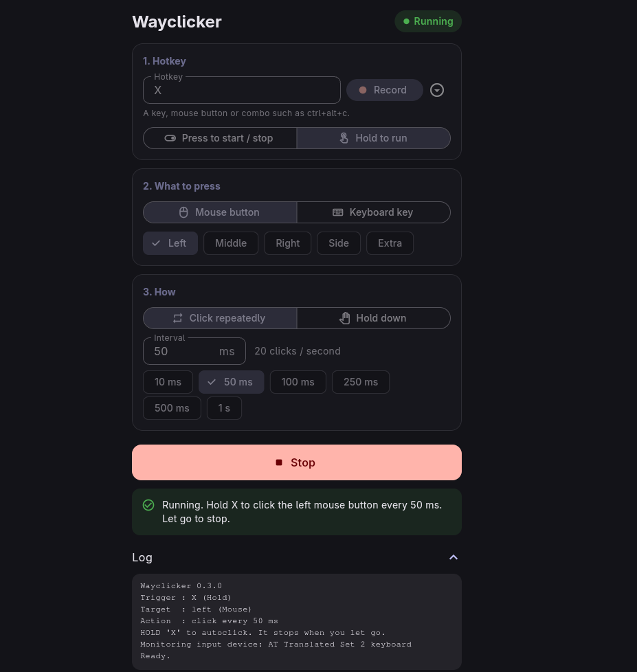
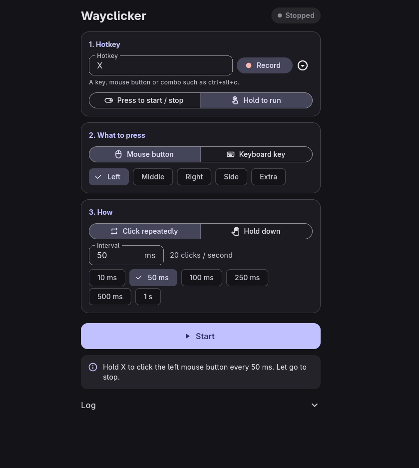

# Wayclicker

A simple autoclicker for Linux. It clicks or holds a mouse button or key when you press a hotkey.

Works on **Wayland and X11**: GNOME, KDE Plasma, Hyprland, Sway, XFCE, Cinnamon and others. It uses the kernel's `uinput`, so it needs no compositor support.

<p align="center">
  
  &nbsp;&nbsp;
  
</p>

## Install

Download a file from the [Releases](https://github.com/Dacraezy1/wayclicker/releases) page.

| Your system | File | Command |
|---|---|---|
| Debian, Ubuntu, Mint | `.deb` | `sudo apt install ./wayclicker_*_amd64.deb` |
| Fedora, RHEL, openSUSE | `.rpm` | `sudo dnf install ./wayclicker-*.rpm` |
| Arch, Manjaro, EndeavourOS | `.pkg.tar.zst` | `sudo pacman -U wayclicker-bin-*.pkg.tar.zst` |
| Any distro | `.AppImage` | `chmod +x Wayclicker-*.AppImage && ./Wayclicker-*.AppImage` |
| Any distro | `.tar.gz` | `tar xzf wayclicker-linux-x64.tar.gz && cd wayclicker-release && sudo ./install.sh` |
| NixOS / Nix | flake | `nix run github:Dacraezy1/wayclicker` |

All packages need GTK 3, which almost every desktop already has.

<details>
<summary>More options</summary>

- **Arch (AUR style):** `packaging/arch-bin/PKGBUILD` (GUI, prebuilt) or `packaging/arch/PKGBUILD` (command line, built from source).
- **NixOS:** add the flake's module and set `programs.wayclicker.enable = true;`. The flake also offers `nix run github:Dacraezy1/wayclicker#cli`. The Nix package is community-tested, so please report problems.
- **Install for your user only:** `PREFIX=$HOME/.local ./install.sh` (from the extracted tarball).
- **Uninstall (tarball install):** `sudo ./uninstall.sh`.
- **Build from source:** install Rust and the Flutter SDK, then run `./build_release.sh`.
- **AppImage command line:** `./Wayclicker-*.AppImage --cli --help`.

</details>

## Use the app

Open **Wayclicker** from your app menu (or run `wayclicker-gui`).

1. **Hotkey.** Pick the key, mouse button or combo that controls the clicker. Type it, choose from the list, or press **Record** and then the key. Choose whether it **starts and stops** on each press, or only runs **while held**.
2. **What to press.** A mouse button (left, middle, right, side, extra) or any keyboard key or combo such as `ctrl+c`.
3. **How.** **Click repeatedly** every N milliseconds, or **Hold down** the button or key until the hotkey stops it.
4. Press **Start**. The text under the button always says in plain words what will happen.

Settings are saved in `~/.config/wayclicker/config.json`. They are locked while running; press **Stop** to change them.

## Permissions

Wayclicker reads your keyboard to see the hotkey and creates a virtual mouse and keyboard. That needs access to `/dev/input` and `/dev/uinput`.

- **Default:** the app asks for your password each time you press **Start** (through `pkexec`, which needs polkit). Stopping never asks again.
- **No password prompts (recommended):** add yourself to the `input` group, then log out and back in.

  ```bash
  sudo usermod -aG input $USER
  ```

  The packages and `install.sh` already install the udev rule and load the `uinput` module. If you used another way to install, copy `packaging/udev/60-wayclicker.rules` to `/etc/udev/rules.d/` and `packaging/modules-load/wayclicker.conf` to `/etc/modules-load.d/`.
- **Check it:** `wayclicker --check-access` prints `OK` when no password is needed.

> The "input" group lets a program read your keyboard. Only add yourself if you are comfortable with that.

If you run a minimal window manager (Sway, Hyprland, i3) without a polkit agent, use the `input` group method.

## Command line

```bash
wayclicker [OPTIONS]
```

| Option | Meaning | Default |
|---|---|---|
| `-t, --toggle-key <KEY>` | Hotkey: `F6`, `F13`, `x`, `BTN_SIDE`, or a combo like `ctrl+alt+c` | `F6` |
| `--trigger-mode <toggle\|hold>` | Press to start/stop, or run only while held | `toggle` |
| `--hold-to-click` | Same as `--trigger-mode hold` | |
| `-b, --button <BTN>` | Mouse button: `left`, `right`, `middle`, `side`, `extra` | `left` |
| `-k, --key <KEY>` | Keyboard key or combo to press instead of a mouse button | |
| `-m, --mode <click\|hold>` | Click repeatedly, or hold the target down | `click` |
| `--hold` | Same as `--mode hold` | |
| `-i, --interval <MS>` | Milliseconds between clicks | `100` |
| `--validate` | Check the key names and exit (no permissions needed) | |
| `--check-access` | Exit `0` if no password or root is needed | |

Without the `input` group setup, run it with `sudo`.

**Examples**

```bash
# Press F6 to start or stop left-clicking every 100 ms
sudo wayclicker

# Hold the right mouse button to rapid-fire right clicks every 25 ms
sudo wayclicker --toggle-key right --hold-to-click --button right --interval 25

# Press F8 to hold the F key down, press F8 again to release
sudo wayclicker --toggle-key F8 --key F --mode hold

# Press Ctrl+Alt+C to press Space every 2.5 seconds
sudo wayclicker --toggle-key ctrl+alt+c --key space --interval 2500

# Hold the mouse side button to keep the left button held down (dragging)
sudo wayclicker --toggle-key BTN_SIDE --hold-to-click --button left --mode hold
```

Key names are not case sensitive. `ctrl`, `alt`, `shift` and `super` match either side. Any raw Linux name such as `KEY_F20` also works.

> Wayclicker only listens to your keyboard, it does not block keys. A hotkey like `ctrl+alt+c` still reaches the focused app, so choose one that does nothing there, or use a spare key such as `F13`.

## Troubleshooting

- **"Cannot open /dev/uinput":** run the installer or package once, or load the module with `sudo modprobe uinput`, and fix permissions as described above.
- **Hotkey does nothing:** run `wayclicker --check-access`; with no access the hotkey cannot be read. Plugging in a keyboard later is fine, devices are detected automatically.
- **No password window appears:** install polkit (`pkexec`) and a polkit agent, or use the `input` group method.
- **Clicks reach nothing:** make sure the target window has focus. Games with anti-cheat may block virtual devices.

## Credits and license

Created by **Dacraezy1**. GUI by **YanamiRei**.
Licensed under the **GNU General Public License v3.0**, see `LICENSE`.
